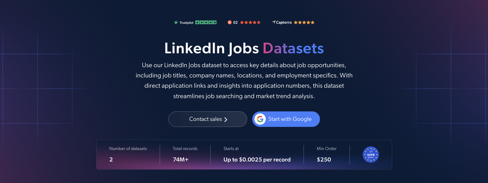

# LinkedIn 职位数据集样本

<h2>包含 1000 条 LinkedIn 招聘信息的示例数据集</h2>

<a href="https://www.bright.cn/products/datasets/linkedin/jobs">
   
</a>

包含 1000 条公开招聘信息的 LinkedIn 职位数据集样本。该数据集通过 <b>Bright Data API</b> 提取。

<h2>数据集中包含的部分数据点：</h2>

* ```url```：LinkedIn 招聘信息的 URL
* ```job_posting_id```：每条招聘信息的唯一标识符
* ```job_title```：招聘职位名称
* ```company_name```：招聘公司名称
* ```company_id```：招聘公司的唯一标识符
* ```company_url```：公司 LinkedIn 主页的 URL
* ```company_logo```：招聘公司的徽标
* ```job_location```：职位所在的地理位置
* ```country_code```：两位字母国家/地区代码
* ```job_summary```：职位及其职责概述
* ```job_description_formatted```：LinkedIn 上显示的格式化职位描述
* ```job_seniority_level```：职位的资历级别
* ```job_employment_type```：全职或兼职等雇佣类型
* ```job_industries```：与职位相关的行业
* ```job_base_pay_range```：公布的薪资范围
* ```base_salary```：结构化基本薪资范围，包括货币和薪资周期
* ```salary_standards```：雇主提供的薪资标准或备注
* ```job_posted_date```：职位发布日期
* ```job_num_applicants```：该职位显示的申请人数
* ```apply_link```：职位申请链接
* ```application_availability```：是否仍接受申请
* ```is_easy_apply```：是否支持 LinkedIn 轻松申请

以及更多内容。

这是“LinkedIn 招聘信息（公共数据）”数据集的示例子集，完整数据集包含超过 <b>19,700,000 条招聘信息</b>。

可用的数据集文件格式：<b>JSON、NDJSON、JSON Lines、CSV 或 Parquet。文件还可选择压缩为 .gz 格式</b>。

数据集交付方式：<b>电子邮件、API 下载、Webhook、Amazon S3、Google Cloud Storage、Google Cloud PubSub、Microsoft Azure、Snowflake、SFTP</b>。

更新频率：<b>单次、每日、每周、每月、每季度、每半年或自定义</b>。

可在提取的数据点基础上添加数据增强服务：<b>根据需求提供。</b>

<b>[获取完整的 LinkedIn 职位数据集](https://www.bright.cn/products/datasets/linkedin/jobs)</b>。

<a href="https://www.bright.cn/products/datasets/linkedin/jobs">
</a>

<h2>LinkedIn 职位数据集有哪些应用场景？</h2>

<h3>1. 就业趋势与劳动力市场研究</h3>
研究人员和商业分析师使用 LinkedIn 职位数据集研究不同行业、地区和资历级别的招聘活动。通过分析职位名称、描述和发布日期，可以识别市场紧缺技能和新兴岗位；定期更新的数据则能揭示招聘模式随时间发生的变化。

<h3>2. 薪资基准与竞争对手分析</h3>
HR 团队可以比较不同竞争企业公布的薪资范围、雇佣类型和职位要求。按照地区和资历级别对同类职位进行分组，有助于开展薪酬基准分析，并帮助企业优化招聘策略。

<h3>3. 招聘与人力规划</h3>
招聘人员可以分析职位描述、申请人数和申请开放状态，了解不同职位的要求及求职者兴趣。这些洞察有助于团队优化招聘信息、确定招聘工作的优先级，并规划未来的人力需求。

<h2>面向学术研究人员和 NGO 免费开放的网页爬虫工具与数据集</h2>

Bright Initiative 为顶尖高校院系和研究人员，以及致力于推动各类环境与社会事业的 NGO 和 NPO，提供 Bright Data 的 <b>[网页爬虫工具 API](https://www.bright.cn/products/web-scraper)</b> 和 <b>[开箱即用的数据集](https://www.bright.cn/products/datasets)</b>。你可以在<b>[此处](https://brightinitiative.com)</b>提交申请。
